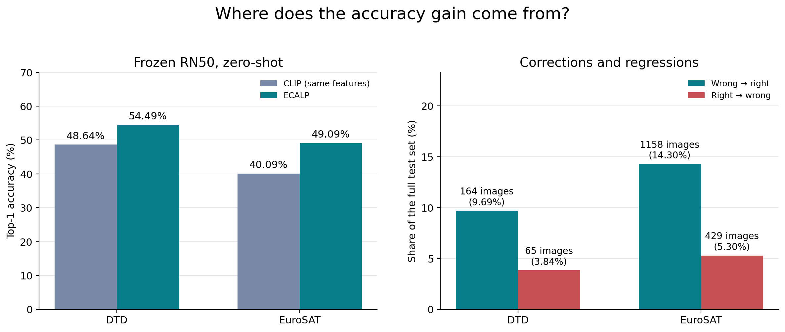
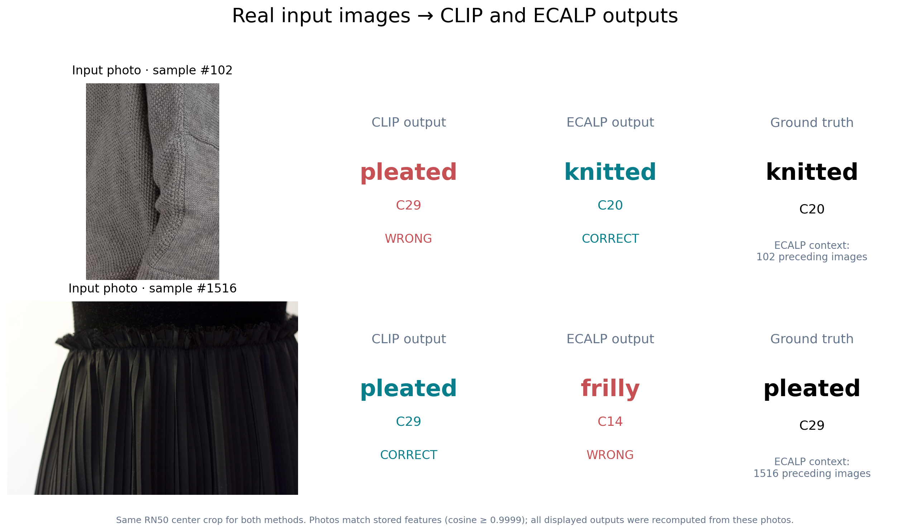

# ECALP 复现与机制分析

《图像与视频处理》课程期末项目，围绕 **Open-Vocabulary Image Classification（开放词汇图像分类）**，复现并分析 ECALP 的训练自由适配方法。

我们关注的问题是：**冻结 CLIP 后，利用测试图像之间的关系和类别上下文，能为分类带来多少提升？**

本仓库基于 [Yushu-Li/ECALP](https://github.com/Yushu-Li/ECALP) 开展课程实验。本组的工作是核心复现、消融分析和可展示的案例整理；算法与原始实现归原论文作者所有。

## 项目入口

| 内容 | 入口 |
|---|---|
| 研究目标、实验范围与四人分工 | [项目计划](docs/PROJECT_PLAN.md) |
| 环境、特征下载与运行命令 | [运行说明](docs/SETUP.md) |
| 本组主结果、日志与分析 | [实验报告](results/main_results.md) |
| 按成员整理的汇报材料 | [presentation/](presentation/README.md) |
| A 的关键图表、原图案例与演示 | [presentation/A/](presentation/A/README.md) |
| 展示流程与原图推理准备 | [演示说明](docs/PRESENTATION.md) |

## 研究内容与分工

实验统一使用 **CLIP RN50**，以 **DTD** 为主要数据集，**EuroSAT** 为第二个验证集，评价指标为 Top-1 Accuracy。

| 成员 | 负责内容 | 回答的问题 | 实验分支 |
|---|---|---|---|
| A（组长兼成员） | 数据、环境、CLIP 基线与完整 ECALP 主结果 | 完整方法提升多少？ | `feat/data-baseline` |
| B | 测试图像之间的连接消融 | 历史测试图像的连接是否有帮助？ | `exp/graph-ablation` |
| C | 上下文感知边权重消融 | 特征维度重加权贡献多少？ | `exp/context-reweight` |
| D | 标签传播与 DTD Few-shot 对比 | 少量真实标签能带来多少帮助？ | `exp/label-propagation` |

目前主分支已收录 A 的实验与展示材料。B/C/D 的消融和 Few-shot 结果待各自实验完成后汇总。

ECALP 的整体流程是：在冻结的 CLIP 特征上，连接类别文本、已观察的测试图像和可选的少样本支持集，通过动态扩图、上下文重加权与迭代标签传播完成分类。


## 本组实测主结果

以下为本组在 **2026-11-15** 完成的 RN50 Zero-shot 实验，两种方法使用相同的官方预提取图像和文本特征。

| 数据集 | 测试图像数 | CLIP 余弦基线 | ECALP | 提升（百分点） | 改对 / 改错 | 净增加正确预测 |
|---|---:|---:|---:|---:|---:|---:|
| DTD | 1,692 | 48.64% | **54.49%** | **+5.85** | 164 / 65 | 99 张 |
| EuroSAT | 8,100 | 40.09% | **49.09%** | **+9.00** | 1,158 / 429 | 729 张 |

ECALP 两项结果与[原论文 Table 1](https://arxiv.org/html/2412.18303v2#S4.T1) 在两位小数上一致。本组基线是“官方预提取文本原型上的 CLIP 余弦分类”，与论文普通 CLIP 行的提示词口径尚未确认一致，增益统一按上表的同特征对照计算。



实测环境：Python 3.10.20、PyTorch 2.6.0+cu124、单张 RTX 3090。原作者测试版本为 PyTorch 1.13.1；环境差异和完整命令已记录。

原始记录：[主结果 CSV](results/main_results.csv) · [逐样本纠错统计](results/demo/summary.csv) · [数据校验清单](results/data_manifest.json) · [环境记录](results/environment.json)。

## 原图输入输出案例

已找回并通过 RN50 特征匹配核对两张 DTD 原图，再从图片重新提取特征、重放对应历史上下文，得到以下输出：

| 案例 | CLIP 输出 | ECALP 输出 | 真实类别 |
|---|---|---|---|
| #102：针织物照片 | pleated（褶皱，错误） | **knitted（针织，正确）** | knitted |
| #1516：褶皱纹理照片 | **pleated（褶皱，正确）** | frilly（褶边，错误） | pleated |



ECALP 在这两个案例中分别使用此前 102 / 1516 张测试图像的特征作为上下文，推理不使用测试真实标签。展示同时保留纠错与退化案例。

### 无 GPU 展示

克隆仓库后即可回放已记录的真实输入输出，仅依赖 Python 标准库：

```bash
git clone https://github.com/Dzz2004/ECALP.git
cd ECALP
python3 presentation/A/demo.py --case 102
python3 presentation/A/demo.py --case 1516
```

图表提供 PNG 和矢量 PDF，可直接用于 PPT；详细讲解顺序见 [A 展示指南](presentation/A/GUIDE.md)。

## 运行实验

### 1. 准备环境

建议使用 Python 3.10：

```bash
python3.10 -m venv .venv
. .venv/bin/activate
python -m pip install -r requirements.txt
```

CPU 环境的安装方式见 [SETUP](docs/SETUP.md)。原图现场编码还需要 `requirements-demo.txt` 和官方 RN50 权重，准备步骤见 [展示说明](docs/PRESENTATION.md)。

### 2. 下载官方特征

特征来自[原作者 Google Drive](https://drive.google.com/drive/folders/10MMCLgnm32XqgS-iPgw0I2Y3y4gzL_47)。

```bash
mkdir -p features_zip
python -m gdown 1-CXxtY77_Zj2Q1T2x0CFN-5a0xjKtz_A -O features_zip/fine_grained.tar.gz --continue
python experiments/prepare_features.py
```

本组所需目录：

```text
features/fine_grained/RN/
├── DTD.pt
├── eurosat.pt
└── few_shots/
    └── DTD.pt
```

特征、模型权重、原始数据集和虚拟环境不提交 Git，成员按说明自行准备。

### 3. 执行主结果与绘图

```bash
# 校验数据格式与标签范围
python experiments/run_main_results.py --inspect-only --device cpu

# 单 GPU 运行；将 0 替换为可用的物理 GPU 编号
python experiments/run_main_results.py --datasets DTD eurosat --device cuda:0

# 生成主结果图
python experiments/plot_main_results.py
```

保留原算法入口，DTD Zero-shot 可直接执行：

```bash
python main.py --task fine_grained --datasets DTD --clip_model RN --mode ZS
```

每个数据集独立启动 ECALP 进程，保留特征文件的原始顺序；运行结果记录命令、参数、日志及数据和源码哈希。

## 仓库结构

```text
ECALP/
├── main.py                  # ECALP 主入口
├── utils/                   # 原论文构图、重加权与标签传播实现
├── experiments/             # 本组实验、绘图及演示脚本
├── docs/                    # 项目计划、环境和展示说明
├── results/                 # 实测 CSV、日志、图表与案例证据
├── presentation/            # 按成员整理的展示材料
│   └── A/                   # A 的主结果、原图案例与演示入口
├── features/                # 外部下载的特征，不进入 Git
├── requirements.txt
└── requirements-demo.txt
```

实验在个人分支开展，通过 PR 汇总到 `master`。统一沿用数据、评价和结果记录约定，避免将论文参考值与本组实测值混用。

## 原论文与致谢

**Efficient and Context-Aware Label Propagation for Zero-/Few-Shot Training-Free Adaptation of Vision-Language Model**，ICLR 2025。

作者：Yushu Li、Yongyi Su、Adam Goodge、Kui Jia、Xun Xu。

[论文](https://arxiv.org/abs/2412.18303) · [OpenReview](https://openreview.net/forum?id=D10yarGQNk) · [原作者代码](https://github.com/Yushu-Li/ECALP)

感谢原作者提供实现与预提取特征，以及 [CLIP](https://github.com/openai/CLIP)、[DMN](https://github.com/YBZh/DMN)、[CoOp/CoCoOp](https://github.com/KaiyangZhou/CoOp) 和 [DTD](https://www.robots.ox.ac.uk/~vgg/data/dtd/) 提供基础模型、数据与相关工具。仓库保留原有 [MIT License](LICENSE)。

```bibtex
@inproceedings{li2025efficient,
  title={Efficient and Context-Aware Label Propagation for Zero-/Few-Shot Training-Free Adaptation of Vision-Language Model},
  author={Yushu Li and Yongyi Su and Adam Goodge and Kui Jia and Xun Xu},
  booktitle={The Thirteenth International Conference on Learning Representations},
  year={2025},
  url={https://openreview.net/forum?id=D10yarGQNk}
}
```
