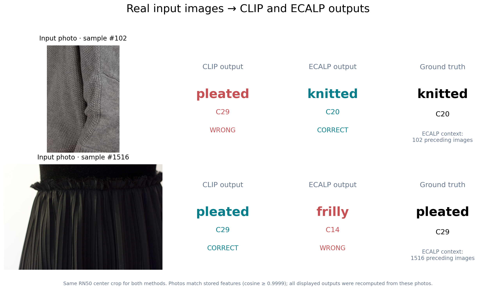
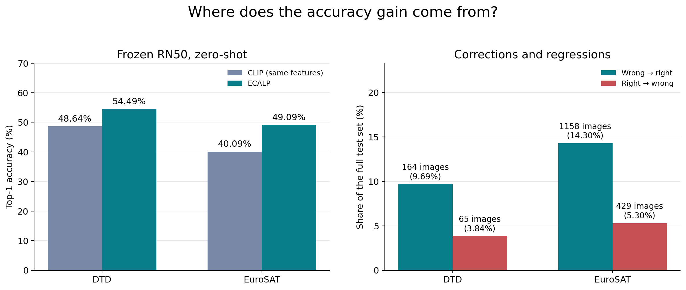

# A 的展示材料：主结果、真实案例与代码回放

本轮直接观测官方推理，补录此前主结果中没有保存的逐样本预测和局部图快照。
两个数据集的导出结果均与第一次正式实验的准确率相符；没有更改图构建、重加权和传播算法。

## 直接输入输出：已找回两张原图



| 输入原图 | CLIP 输出 | ECALP 输出 | 真实类别 |
|---|---|---|---|
| [针织物 #102](cases/images/DTD_102_knitted_0179.jpg) | pleated（褶皱） | **knitted（针织，正确）** | knitted（针织） |
| [褶皱纹理 #1516](cases/images/DTD_1516_pleated_0060.jpg) | **pleated（褶皱，正确）** | frilly（褶边，错误） | pleated（褶皱） |

这两组输出已经通过**实际读取原图、运行冻结 RN50 编码、重放对应历史前缀并调用原版传播函数**得到，
与原实验的逐样本记录一致。现场演示命令：

```bash
.venv/bin/python experiments/predict_image_case.py --case 102 --cuda-device 4
.venv/bin/python experiments/predict_image_case.py --case 1516 --cuda-device 4

# 也支持替换输入图片；新图片的真实类别不会自动假定。
.venv/bin/python experiments/predict_image_case.py --image /absolute/path/to/photo.jpg --history-count 102 --cuda-device 4
```

两种方法处理同一张图片的 224 像素中心裁剪；ECALP 还使用此前 102 / 1516 个测试图像的特征。
历史真实标签没有送入推理。需要在演示时说明这一上下文条件，ECALP 的输出依赖已观察的测试流。

原图来自 [DTD 公开镜像](https://huggingface.co/datasets/cansa/Describable-Textures-Dataset-DTD)，
以 [DMN 的 DTD 划分](https://github.com/YBZh/DMN/blob/main/data/data_splits/split_zhou_DescribableTextures.json)
核对类别。候选图片字节与镜像 LFS SHA-256 相符；图像重新编码后与原特征的余弦分别约为
**0.999953 / 0.999999**，次优候选约为 0.891658 / 0.849125。
匹配规则固定为余弦 ≥0.9999、领先次优候选至少 0.001，并要求真实类别相同。
未达到阈值的候选未用于配图。失败案例选取两个已下载类别中，前 100 张之后首个满足该匹配条件的退化样本。
证据保存在 `results/demo/image_matches.json` 和 `results/demo/live_outputs/`。

首次准备原图演示环境与资产，或重新生成：

```bash
.venv/bin/python -m pip install -r requirements-demo.txt
.venv/bin/python experiments/prepare_image_cases.py
.venv/bin/python experiments/match_image_cases.py --sample-indices 102 --find-regression --cuda-device 4
.venv/bin/python experiments/predict_image_case.py --case 102 --cuda-device 4
.venv/bin/python experiments/predict_image_case.py --case 1516 --cuda-device 4
.venv/bin/python experiments/plot_image_cases.py
```

RN50 权重和候选数据保存在忽略提交的 `.cache/raw-case-assets/`；RN50 校验和与 OpenAI 官方发布值一致。
仅展示所需的两张原图保存在 `results/demo/images/`。已有图片和输出时，最后一条命令可在 CPU 上生成图表。
输出同时提供 [PNG](figures/real_image_input_output.png) 与 [矢量 PDF](figures/real_image_input_output.pdf)。

## 1. 最适合放进 PPT 的图

每张图同时提供 200 DPI PNG 与矢量 PDF，位于 `results/demo/figures/`。

| 图 | 建议用途 | 讲解重点 |
|---|---|---|
| [准确率与纠错/退化](figures/accuracy_and_corrections.png) · [PDF](figures/accuracy_and_corrections.pdf) | 主结果页，优先使用 | 整体准确率提高，同时展示改对和改错的数量 |
| [完整四格统计](figures/paired_outcomes.png) · [PDF](figures/paired_outcomes.pdf) | 实验分析页 | 全部测试样本都进入统计，没有只挑成功案例 |
| [成功与失败案例](figures/case_comparison.png) · [PDF](figures/case_comparison.pdf) | 案例页 | 同一样本上两种方法做出了什么决定 |
| [实际局部 KNN 图](figures/local_graph_case.png) · [PDF](figures/local_graph_case.pdf) | 方法与案例衔接页 | 当前样本连接到哪些文本原型和历史图像 |
| [随样本到达的累计准确率](figures/stream_accuracy.png) · [PDF](figures/stream_accuracy.pdf) | 补充分析页 | 这是固定输入顺序下的推理过程，不是训练曲线 |



## 2. 全量统计

| 数据集 | CLIP 对→ECALP 对 | CLIP 错→ECALP 对 | CLIP 对→ECALP 错 | 两者都错 | 净增加正确预测 |
|---|---:|---:|---:|---:|---:|
| DTD（1,692 张） | 758 | 164 | 65 | 705 | **99 张** |
| EuroSAT（8,100 张） | 2,818 | 1,158 | 429 | 3,695 | **729 张** |

DTD：164 − 65 = 99；99 / 1692 = 5.85 个百分点。
EuroSAT：1158 − 429 = 729；729 / 8100 = 9.00 个百分点。
百分比均以完整测试集为分母。

## 3. 现场代码回放，不需要 GPU

在仓库根目录执行即可，回放脚本只依赖 Python 标准库，不需要重新运行推理。

```bash
# 先看纠错案例，再看失败案例。
python3 experiments/demo_cases.py --dataset DTD --outcome corrected --limit 1
python3 experiments/demo_cases.py --dataset DTD --outcome regressed --limit 1

# 查询任意样本索引；也可把 DTD 换成 eurosat。
python3 experiments/demo_cases.py --dataset DTD --sample-index 102
python3 experiments/demo_cases.py --dataset eurosat --sample-index 101
```

回放会输出真实类别、CLIP / ECALP 预测、CLIP 前三名余弦相似度，以及保存的历史邻居伪标签。
每类结果保留前 100 张到达之后遇到的前三个案例及图快照；全部样本均保留预测记录。
任意索引都可查询预测，但只有预先选定的案例有图快照。

### 建议的 2 分钟演示顺序

1. 用主结果图介绍：冻结 RN50，DTD / EuroSAT 分别提高 5.85 / 9.00 个百分点。
2. 用四格统计说明：DTD 改对 164 张、改错 65 张，净收益为 99 张。
3. 查询 DTD `#102`：真实类别 C20；CLIP 预测 C29，ECALP 预测 C20。
   CLIP 的 C29 / C20 余弦仅约 0.251 / 0.247，展示一个相似度接近的纠错实例。
4. 展示其局部图：历史节点 #72、#46 在本次传播之前的伪标签都是 C20。
   这说明方法实际使用了哪些上下文；不能仅凭图断言具体某条边造成了纠错。
5. 查询 DTD `#166`：真实类别 C29，CLIP 正确，ECALP 改成 C17。
   用它说明图传播也可能引入错误，需要消融解释各个机制的贡献。

EuroSAT 的对应示例：`#101` 从 C04 改为正确的 C07；`#138` 从正确的 C00 改为 C02。
所有索引从 0 开始，`#102` 是特征文件中的第 103 个样本。

## 4. 数据来源和展示边界

- `results/demo/<dataset>_predictions.csv`：完整逐样本记录。
- `results/demo/<dataset>_cases.json`：按固定规则选出的成功、退化及两者相同的案例，含实际 KNN 邻居。
- `results/demo/<dataset>_metadata.json`：官方特征哈希、算法源码哈希、正式实验参照和全量统计。
- `results/demo/summary.csv`：可直接粘贴进表格软件的汇总。
- 历史邻居的标签是**当前样本推理之前的伪标签**；测试集真实标签只在推理结束后用于评分和案例分类。
- 局部图展示当前查询选出的 KNN 连接，省略当前样本自身及副本，也未画出对称化后额外的入边。
  节点位置为示意排版，不代表特征距离。
- 只展示 CLIP 余弦排名和两种分类决定，不把不同方法的输出直接当成可比较的校准置信度。
- 官方 `.pt` 没有原图路径、样本 ID 映射和类别名称表。新增的两张原图通过上文的严格特征匹配恢复，
  类别名称由 DMN 划分核对；其余编号案例仍不随意配图。

## 5. 重新生成展示材料

首次导出使用单张 RTX 3090。每个数据集单独进程，避免历史图状态复用：

```bash
.venv/bin/python experiments/collect_demo_predictions.py --dataset DTD --device cuda:4
.venv/bin/python experiments/collect_demo_predictions.py --dataset eurosat --device cuda:4
.venv/bin/python experiments/plot_demo_results.py
```

已有逐样本 CSV / JSON 时，只运行最后一条绘图命令即可，不需要 GPU 或重新推理。
