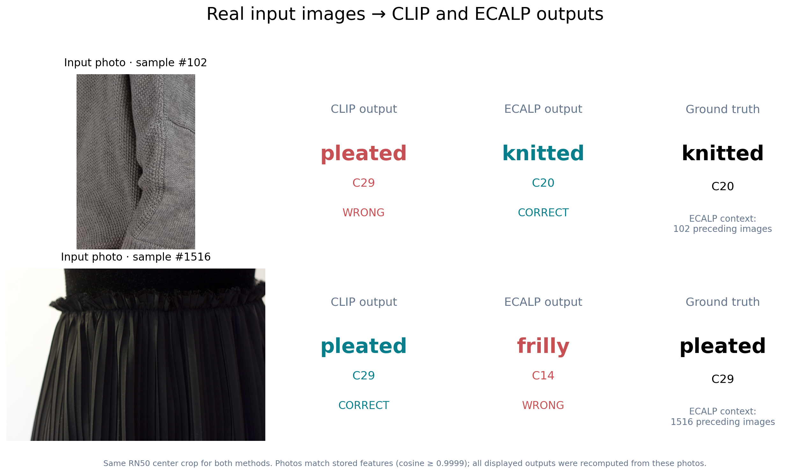

# A：主结果与原图输入输出演示

本目录可直接用于制作 PPT。所有数值来自本组 RN50 Zero-shot 实测，图表同时提供 PNG / PDF。

## 优先展示这三页

1. **主结果与收益来源**：[准确率及纠错统计](figures/accuracy_and_corrections.png) · [PDF](figures/accuracy_and_corrections.pdf)。
2. **具体输入输出**：[两张真实原图的成功 / 失败案例](figures/real_image_input_output.png) · [PDF](figures/real_image_input_output.pdf)。
3. **方法如何使用上下文**：[实际局部 KNN 图](figures/local_graph_case.png) · [PDF](figures/local_graph_case.pdf)。



## 关键数据

| 数据集 | 测试数 | 同特征 CLIP | ECALP | 提升（百分点） | 改对 / 改错 | 净增加正确预测 |
|---|---:|---:|---:|---:|---:|---:|
| DTD | 1,692 | 48.64% | 54.49% | +5.85 | 164 / 65 | 99 |
| EuroSAT | 8,100 | 40.09% | 49.09% | +9.00 | 1,158 / 429 | 729 |

ECALP 两项结果与论文报告值在两位小数上一致。本组使用同特征余弦分类作为对照，
不能用论文普通 CLIP 的数值替换这里的实测基线。

- [完整实测结果 CSV](results/main_results.csv)
- [纠错 / 退化统计 CSV](results/correction_summary.csv)
- [环境记录](results/environment.json)
- [数据哈希清单](results/data_manifest.json)

## 原图案例与演示入口

| 案例 | 输入 | CLIP 输出 | ECALP 输出 | 真实类别 |
|---|---|---|---|---|
| #102 | [针织物照片](cases/images/DTD_102_knitted_0179.jpg) | pleated（褶皱） | **knitted（针织，正确）** | knitted |
| #1516 | [褶皱纹理照片](cases/images/DTD_1516_pleated_0060.jpg) | **pleated（褶皱，正确）** | frilly（褶边，错误） | pleated |

从仓库根目录运行：

```bash
# 无需 GPU：显示原图路径与已经现场计算过的输入输出。
python3 presentation/A/demo.py --case 102
python3 presentation/A/demo.py --case 1516

# 有 GPU：实际读取本目录的照片，现场编码并重放相同历史上下文。
python3 presentation/A/demo.py --case 102 --live --cuda-device 4
```

现场推理需要之前准备的 `.venv`、官方特征和 RN50 权重；完整准备命令见 [GUIDE](GUIDE.md)。
ECALP 在这两个案例中分别使用之前 102 / 1516 张测试图像作为上下文，推理不使用历史真实标签。

## 文件组织

```text
presentation/A/
├── README.md          # 展示入口、关键结果与推荐顺序
├── GUIDE.md           # 详细讲解、数据来源与重生成命令
├── demo.py            # 无 GPU 回放 / GPU 现场推理入口
├── figures/           # 主结果、原图案例、四格统计、局部图、累计准确率等
├── cases/
│   ├── images/        # 已核对匹配的两张原图
│   ├── outputs/       # 两次真实原图推理的输出 JSON
│   ├── image_matches.json
│   └── class_names.json
├── results/           # 实测 CSV、环境与数据清单
├── evidence/          # 核对记录及第一次正式实验日志
└── SOURCE_MANIFEST.json  # 文件来源与 SHA-256
```

补充图表：[完整四格统计](figures/paired_outcomes.png)、[累计准确率](figures/stream_accuracy.png)、
[编号案例对比](figures/case_comparison.png)、[简版主结果](figures/main_results.png)。

本目录是当前展示快照。推理和绘图实现保留在仓库的 `experiments/`，完整逐样本数据保留在 `results/demo/`。
