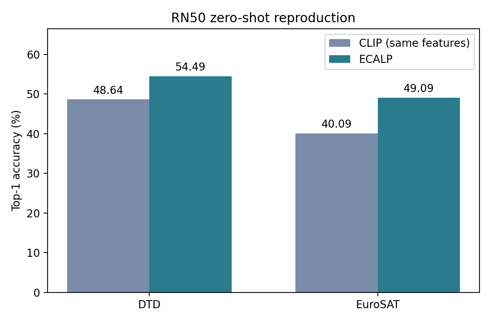

# 第一次正式实验：RN50 Zero-shot 主结果

日期：2026-11-15（Asia/Shanghai）。运行编号：`20261115T105603455074Z`。

## 本组实测结果（source=ours）

| 数据集 | 测试图像数 | 同特征 CLIP (%) | ECALP (%) | 提升（百分点） | ECALP 子进程耗时（秒） |
|---|---:|---:|---:|---:|---:|
| DTD | 1692 | 48.64 | 54.49 | +5.85 | 13.84 |
| EuroSAT | 8100 | 40.09 | 49.09 | +9.00 | 60.84 |



两组方法使用同一份官方 RN50 图像特征、文本原型和标签，保留归档内原始样本顺序。
CLIP 使用归一化后的图文余弦相似度 argmax；ECALP 保留原算法，仅在主入口加载数据时
指定设备。测试真实标签只用于评分，未传入传播函数。

## 运行设置与复现

- Python 3.10.20，PyTorch 2.6.0+cu124，单张 NVIDIA GeForce RTX 3090（物理编号 4）。
- Baseline 在 CPU 上计算；ECALP 在 GPU 上计算。表中时间含子进程启动和特征加载，
  不包含 CLIP 编码器特征提取，不能用于直接对比论文端到端时延或计算加速比。
- `k_text=3, k_image=8, k_fewshot=8, gamma=10, alpha=1, T=3, beta=0.2`，本轮无支持集参与。
- 基础 Git commit：`d8c139ec0533ebc573d55c40ca31367919c029e4`。实验时工作区未提交，实际源码以运行元数据中的 SHA-256 为准。

```bash
.venv/bin/python experiments/run_main_results.py --datasets DTD eurosat --device cuda:4
.venv/bin/python experiments/plot_main_results.py
```

## 论文参考与基线口径

以下仅为 [ECALP 论文 Table 1](https://arxiv.org/html/2412.18303v2#S4.T1)
的 `paper_reference`，没有混入实测 CSV：

| 数据集 | 论文普通 CLIP (%) | 论文 ECALP (%) | 本组 ECALP 与论文之差（百分点） |
|---|---:|---:|---:|
| DTD | 40.37 | 54.49 | 0.00 |
| EuroSAT | 23.69 | 49.09 | 0.00 |

本组 ECALP 两项结果均与论文在两位小数上相符。**本组同特征 CLIP 基线为 48.64% / 40.09%，
高于论文普通 CLIP 的 40.37% / 23.69%，不能混用两组基线来报告本组增益。**
DTD 基线在两位小数上也恰与论文 CuPL 行相同，但这不足以证明文件的具体提示词来源；
EuroSAT 同特征基线也不等于论文 CuPL 行的 38.38%。两个特征文件仅含
`image_features, text_features, labels`，没有可直接核实提示词内容的元数据。
后续汇报统一称为“官方预提取文本原型上的 CLIP 余弦基线”。

## 可用于汇报的简短分析

在冻结 RN50 特征、保持输入顺序和默认超参数的条件下，ECALP 在 DTD 和 EuroSAT 上
分别达到 54.49% 和 49.09%，与论文报告值一致。相对同批特征上的 CLIP 余弦分类，
准确率分别提高 5.85 和 9.00 个百分点，说明该图传播适配流程在这两个数据集上有效。
EuroSAT 的增益更大，但主结果尚不能区分图像连接和上下文重加权各自的贡献，
需要 B、C 的消融进一步解释。由于预提取文本原型的提示词来源未完全核实，
本组只报告同特征对照的增益；当前为单次固定顺序实验，也不据此判断随机顺序的稳定性。

## 证据与限制

- [实测 CSV](main_results.csv)、[数据哈希清单](data_manifest.json)、[运行环境](environment.json)。
- [本次元数据](logs/20261115T105603455074Z/metadata.json)，含每项特征检查、命令、参数和源码哈希。
- [DTD CLIP 日志](logs/20261115T105603455074Z/DTD_clip.log)、[DTD ECALP 日志](logs/20261115T105603455074Z/DTD_ecalp.log)。
- [EuroSAT CLIP 日志](logs/20261115T105603455074Z/eurosat_clip.log)、[EuroSAT ECALP 日志](logs/20261115T105603455074Z/eurosat_ecalp.log)。
- 当前 PyTorch 与原论文测试的 1.13.1 不同；虽然本轮数值吻合，干净环境安装和跨机器复现仍未验证。
- Few-shot 特征已经下载，本轮没有运行 Few-shot 或消融实验。
